## À propos

Développeur en France, passé par le BUT Informatique. Je construis surtout des outils auto-hébergés et documentés.

- **Consoles portables** : un accueil console pour la ROG Ally, en Rust, essayé sur une ROG Ally RC71L
- **LLM en local** : faire tourner de gros modèles sur du matériel grand public
- **Auto-hébergement** : carnet d'entretien de véhicules, coach de langue, assistant vocal

## Stack

  

## Projets

Canapé sur ROG Ally, la bibliothèque de jeux pilotée à la manette · [site](https://pierregouedar.github.io/canape-site/) · capture du simulateur, valeurs fictives

  
  
  
  
  

## Activité

  
  

