## Pierre

Je construis des logiciels que j'utilise chez moi : un accueil console pour ma ROG Ally, des LLM qui tournent sur un GPU de 10 Go, des services auto-hébergés. Chaque projet est documenté et testé sur du vrai matériel.

`France · Rust · TypeScript · Python`

Canapé, la bibliothèque de jeux pilotée à la manette. Capture du simulateur, valeurs fictives

### Projets

| Projet | Ce que ça fait | Stack |
|---|---|---|
| [Canapé](https://github.com/pierregouedar/canape) | Remplace l'accueil Xbox sur la ROG Ally : jeux Steam, Epic, GOG et Xbox, auto TDP, profils par jeu. [Site](https://pierregouedar.github.io/canape-site/) | `rust` `slint` |
| [Klonk](https://github.com/pierregouedar/klonk) | Carnet d'entretien de véhicules auto-hébergé, avec rappels des échéances légales en France et en Europe | `next.js` `postgres` `pwa` |
| [Learnee](https://github.com/pierregouedar/learnee) | Coach de langue : lire un article, le résumer, écrire dans la langue étudiée, correction notée sur 20 | `next.js` `typescript` |
| [Murmure](https://github.com/pierregouedar/murmure) | Assistant vocal français auto-hébergé, reconnaissance et synthèse vocale en local | `python` |
| [llm-local-stack](https://github.com/pierregouedar/llm-local-stack) | Un modèle MoE de 35B sur un GPU de 10 Go avec llama.cpp et llama-swap, joignable via Tailscale | `powershell` `llama.cpp` |

### Activité

<picture>
  <source media="(prefers-color-scheme: dark)" srcset="./profile/stats-dark.svg">
  
</picture>
<picture>
  <source media="(prefers-color-scheme: dark)" srcset="./profile/top-langs-dark.svg">
  
</picture>
